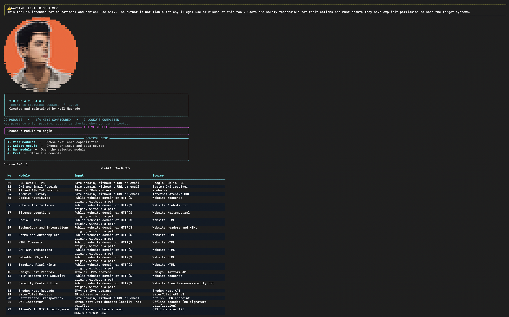

# ThreatHawk

**Threat intelligence, DNS analysis, and website inspection from one guided terminal.**

[](LICENSE)


[](https://github.com/neilmachado/ThreatHawk-Standalone/actions/workflows/tests.yml)

Created and maintained by **Neil Machado**.

ThreatHawk brings 22 research and inspection modules into a consistent workflow. Choose a module, enter an indicator, and review a plain-language summary with technical details available when needed.

[Quick start](#quick-start) · [Modules](docs/CAPABILITIES.md) · [Usage](#usage) · [Contributing](CONTRIBUTING.md)

## Overview



## Features

- **Threat intelligence:** host and indicator reports from Censys, Shodan, VirusTotal, and AlienVault OTX.
- **DNS and infrastructure:** DNS records, SPF and DMARC, DNS over HTTPS, IP ownership, and ASN information.
- **Website inspection:** headers, cookie attributes, technology clues, forms, social links, and published metadata.
- **Historical records:** certificate transparency and Internet Archive lookups.
- **Offline JWT inspection:** decode headers and claims locally, with verification status clearly identified.
- **Guided interface:** numbered modules, input examples, readable summaries, and optional technical details.

Explore the [complete module reference](docs/CAPABILITIES.md) for inputs and data sources.

## Quick start

Requires **Python 3.10+**. On macOS or Linux:

```sh
git clone https://github.com/neilmachado/ThreatHawk-Standalone.git
cd ThreatHawk-Standalone
python3 -m venv .venv
source .venv/bin/activate
python -m pip install .
threathawk
```

DNS, website inspection, and several public data sources work without API keys. To enable authenticated providers, configure the variables below in your environment.

| Provider | Environment variable |
|---|---|
| Censys Platform | `CENSYS_PAT` |
| Shodan | `SHODAN_API_KEY` |
| VirusTotal | `VIRUSTOTAL_API_KEY` |
| AlienVault OTX | `OTX_API_KEY` |

For local configuration:

```sh
cp .env.example .env
# Edit .env with your provider credentials.
source .env
threathawk
```

Keep `.env` private; it is excluded from version control. The application reads environment variables and does not automatically load `.env`. Account plans, permissions, and quotas determine provider access.

## Usage

```text
1. View modules
2. Select module
3. Run module
4. Exit
```

Choose a module and follow its input guidance. For example, select **02 — DNS and Email Records**, then enter `example.com`.

| Control | Action |
|---|---|
| Enter an indicator | Run the selected module |
| `Enter` | Show input guidance |
| `d` | View technical details from the last response |
| `b` | Return to the home screen |
| `q` | Exit |
| `r`, when offered | Request the displayed same-site HTTPS redirect destination |

Results include a summary and selected findings. Large technical responses are shortened with explicit notices. Results are displayed in the terminal; the application does not save reports or run logs.

## Scope and interpretation

Website checks inspect a single response per execution, with TLS verification, response-size limits, and timeouts. Links, scripts, forms, and redirects are not followed automatically. Intrusive scanning and exploitation are excluded.

Provider reports and website observations require context: a detection is not a definitive verdict, and missing findings do not establish safety. JWT decoding does not verify signatures or claims. **VirusTotal documents that queried indicators may be scanned and added to its dataset**; avoid confidential indicators. See [provider references](docs/REFERENCES.md) and [security guidance](SECURITY.md).

## ⚠️ WARNING: LEGAL DISCLAIMER

This tool is intended for **educational and ethical use only**. The author is not liable for any illegal use or misuse of this tool. Users are solely responsible for their actions and must ensure they have explicit permission to scan the target systems.

## Development

```sh
python -m pip install '.[test]'
python -m pytest tests -q
```

Automated tests use synthetic responses and require no live API credentials. See [validation](docs/VALIDATION.md), [contribution guidelines](CONTRIBUTING.md), and the [changelog](CHANGELOG.md).

## License

Licensed under the [MIT License](LICENSE). Third-party dependencies and services retain their respective licenses and terms. [Implementation provenance](docs/PROVENANCE.md).
